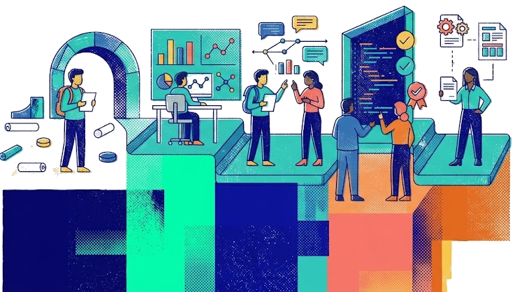
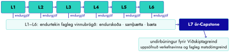
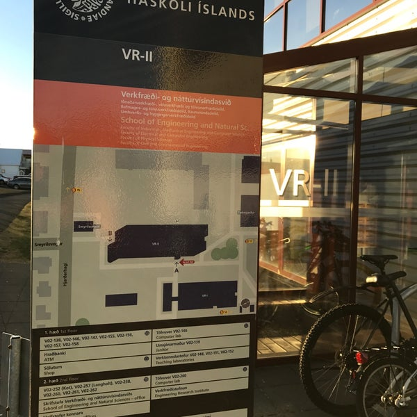



## Áskorunin

Nemendur þurfa að læra að vinna með gögn, greina þau saman og miðla niðurstöðum.

::: {.fa-card cols=3}
- database | **Raungögn** | Spyrja góðra spurninga og vinna með gögn
- code-branch | **Samvinna** | Rýna vinnu og bregðast við endurgjöf
- repeat | **Gæði** | Skjalfesta og gera vinnu endurtakanlega
:::

::: {.context-box}
Þetta er samspil tækni, greiningar og samvinnu. Nemendur [læra heilt faglegt vinnuferli]{.hl}, ekki aðeins forritun eða ný greiningartól.
:::

> Hvernig æfum við nemendur í faglegum vinnubrögðum án þess að flækjustigið verði yfirþyrmandi?

::: {.yellow-takeaway}
**Einfalda þarf inngönguna en halda gæðakröfunum.**<br>Stuðningur er mikill í upphafi og minnkar eftir því sem sjálfstæði eykst.
:::

## Lærdómur úr Viðskiptagreind (IÐN610M)

:::: {.two-col}
::: {.col}
::: {.context-box .tight}
Nemendur vinna þar með flókin verkefni og raungögn frá ytri samstarfsaðila.

```{=html}
<ul class="icon-list">
<li><i class="fa-solid fa-chart-line fa-fw"></i><span><strong>Greining:</strong> opnar spurningar og krefjandi gögn</span></li>
<li><i class="fa-solid fa-code-branch fa-fw"></i><span><strong>Vinnubrögð:</strong> GitHub, pull requests, samvinnurýni og miðlun</span></li>
</ul>
```

[Þau þurftu að læra hvort tveggja samtímis.]{.hl}
:::

::: {.context-box}
Það varð kveikjan að því að færa grunnvinnubrögðin fyrr í námsleiðina.
:::
:::

::: {.col}
{width=100% style="max-height: 390px; object-fit: cover; object-position: right center;"}
:::
::::

Í Upplýsingaverkfræði æfa nemendur sama ferli fyrr með **opnum gögnum**:

::: {.steps}
- Spurningar
- Gögn
- Greining
- Skjalfesting
- Rýni
- Miðlun
:::

## Stigvaxandi verkefnalotur

::: {.fa-card cols=3}
- laptop-code | **Rýna vinnuna** | Skýrslur, gögn, kóði, pull requests og jafningjarýni
- comments | **Draga lærdóm** | Kennari greinir sameiginleg mynstur þvert á teymi
- rotate | **Nota strax** | Nemendur nýta endurgjöf í næstu lotu
:::

Þetta endurtekur sig eftir hverja lotu og tengir loturnar saman:

{.nostretch fig-alt="Sex lotur, L1 til L6, í röð með endurgjöf eftir hverja lotu. Endurtekin fagleg vinnubrögð í lotunum leiða að L7 ör-Capstone, sem er undirbúningur fyrir Viðskiptagreind." width=100% style="display:block;margin:auto"}

::: {.context-box}
**Lotur mynda eitt samhangandi ferli:** sömu grunnvinnubrögð endurtaka sig í nýju samhengi. [Umfang eykst, stuðningur minnkar og sjálfstæði vex.]{.hl}
:::

## Pull requests: sýnilegt ferli, faglegt mat

::: {.fa-card cols=1}
- code-pull-request | **Pull request (PR)** | Tillaga að breytingu á kóða sem aðrir rýna og samþykkja áður en hún er sameinuð í verkefnið. | > Ingimundardóttir, H. (2026). Using pull requests to make collaboration visible in CDIO project-based courses. _Proceedings of the 22nd International CDIO Conference_. CDIO Initiative.
:::

Lokaskýrsla sýnir afurðina. PRs sýna tillögu, jafningjarýni, viðbrögð og endurskoðun.

::: {.fa-card cols=3}
- eye | **Sýnileg virkni** | Commits, pull requests og athugasemdir | >> Mælir þátttöku, ekki gæði. PRs sýna aðeins hluta samstarfsins.
- list-check | **Gæði vinnubragða** | Afmörkun, skjalfesting og endurtekning | >> Metið með faglegum viðmiðum og dæmum.
- magnifying-glass-chart | **Gæði greiningar** | Aðferðir, röksemdir og niðurstöður | >> Dæmi hjálpa nemendum að velja næstu úrbætur.
:::


---

## Brú milli byrjendakennslu og faglegra krafna

Upplýsingaverkfræði á að leggja grunn að áframhaldandi þróun faglegra vinnubragða.

::: {.fa-card cols=3}
- chart-line | **Flóknari verkefni** | Opnari og flóknari greiningarverkefni í áframhaldandi námi
- handshake | **Samstarf við ytri aðila** | Undirbúa nemendur til að vinna með gögn frá fyrirtækjum og stofnunum
- bullhorn | **Fagleg miðlun** | Rýni og niðurstöður fyrir ólíka hagaðila
:::

::: {.context-box}
Markmiðið er ekki aðeins að bæta eitt námskeið. [Vinnubrögðin eiga að nýtast í öðrum námskeiðum og síðar í starfi.]{.hl}
:::
## {.focus-slide}

::: {.two-col}
::: {.col}
{.contact-photo style="max-height: 520px;"}
:::

::: {.col}
```{=html}
<h2>Til umræðu</h2>
<div class="closing-q">Hvernig tengjum við námið við atvinnulífið?</div>
<div class="closing-q">Hvernig metum við starfstengda hæfni?</div>
<div class="closing-q">Hvernig drögum við úr stuðningi án þess að slaka á gæðakröfum?</div>
```


:::
:::
